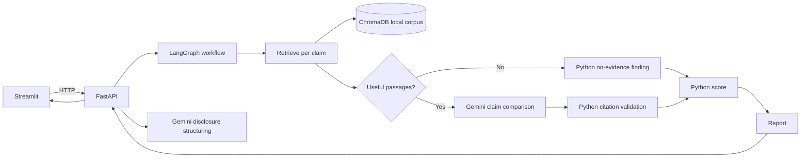

# IP Lens

IP Lens searches an uploaded corpus of patent documents for passages related to reviewed invention claims. It compares each claim with retrieved evidence and prepares a source-linked report for a human reviewer. It uses a local Streamlit interface, FastAPI, LangGraph, and ChromaDB, with Gemini for disclosure structuring and claim comparison. It is a research aid, not legal advice or a patentability decision.

## How it works



The two Gemini-backed steps are disclosure structuring and claim comparison. Retrieval, passage-label mapping, citation validation, evidence-status assignment, score calculation, and report assembly stay in Python. Comparison prompt v2 assesses technical elements independently; v1 remains selectable. Only findings with `evidence_status="evidence"` contribute to the score.

Findings use four statuses:

- `evidence`: at least one retrieved passage was cited and validated.
- `no_evidence`: no passage reached `MIN_SIMILARITY`.
- `no_supporting_passage`: useful passages were compared, but the model cited none.
- `unsupported`: the model cited passages, but all citation references were invalid.

The score is `round(0.65 * max_claim_coverage + 0.35 * best_cited_retrieval_similarity)`. Bands are Low (0–34), Moderate (35–69), and High (70–100). When no finding has evidence, the score is null and the band is **Not scored**. This is an unvalidated triage heuristic, not a probability or legal conclusion.

## Setup

The repository pins Python 3.12 in `.python-version`; `pyproject.toml` also permits Python 3.11–3.13. Install [uv](https://docs.astral.sh/uv/) and run these commands from the project root:

```powershell
uv sync
Copy-Item .env.example .env
```

Set `GEMINI_API_KEY` in `.env`. The default retrieval settings are `MIN_SIMILARITY=50` and `DEFAULT_TOP_K=4`. Keep `.env` private. The current public Gemini API integration is unsuitable for confidential disclosures because disclosure text and retrieved excerpts are sent to that provider.

Start the API:

```powershell
uv run uvicorn backend.app.main:app --reload --port 8000
```

In a second terminal, start Streamlit:

```powershell
uv run streamlit run frontend/streamlit_app.py
```

The app defaults to English indexing (`INDEX_LANGUAGES=["en"]`). Use the uploader to index the five synthetic prior-art documents in `examples/synthetic_prior_art_01.txt` through `synthetic_prior_art_05.txt`. Bulk-ingest a folder of supported files with:

```powershell
uv run python scripts/ingest_folder.py examples/real
```

## Demo

1. Paste the fictional disclosure from [`examples/demo_disclosure.md`](examples/demo_disclosure.md) into the Disclosure section and extract candidate claims.
2. Review and edit the claims. [`examples/demo_claims.json`](examples/demo_claims.json) contains the four prepared claim texts and their demo IDs for reproducible API requests; the API accepts `{ "claim_id": "…", "text": "…" }` objects or plain claim strings.
3. Keep prompt v2 selected (the default), run the analysis, and review each status, missing element, excerpt, filename, and page.
4. Inspect the score components and download the JSON or Markdown report. Sample exports are [`outputs/demo_report.md`](outputs/demo_report.md) and [`outputs/prompt_comparison.md`](outputs/prompt_comparison.md).

## Evaluation

On the 13 answerable retrieval labels, chunk-level Recall@1 was 1/13 (7.7%) and Recall@4 was 10/13 (76.9%); document-level Recall@1 was 12/13 (92.3%) and Recall@4 was 13/13 (100%). Threshold 50 was the lowest tested threshold with neither no-answer claim returning passages. In the seven-case prompt comparison, both prompts were schema-valid in 21/21 attempts with no discarded citations; v2 had lower mean coverage spread (2.0 vs 7.5) and no claim-reference elements (0 vs 7). v2 is the workflow and API default. See [`docs/EVALUATION.md`](docs/EVALUATION.md) and the [prompt-comparison output](outputs/prompt_comparison.md) for methodology and detail.

## Limitations

- Search covers only the documents indexed in the local corpus; it is not an exhaustive prior-art search.
- English pages are indexed by default. German-language EP publications are excluded under the current setting; two of the 50 published patents in the evaluation set were rejected for this reason.
- Coverage judgments can vary between model runs. The held-out comparison claims were easy, single-feature matches and do not establish generalization.
- The public Gemini API is unsuitable for confidential disclosures. Provider access is isolated in `backend/app/services/gemini.py` so it can be replaced with approved infrastructure.
- Scanned PDFs are unsupported because OCR is not implemented. Drawing sheets are skipped heuristically and may occasionally contain useful labels.
- The recorded prompt-comparison run used `gemini-3.5-flash-lite`; results may differ with another model or corpus.

For the complete scope and implementation decisions, see [`PROJECT_SPECIFICATION.md`](PROJECT_SPECIFICATION.md), [`DESIGN-CHANGES.md`](DESIGN-CHANGES.md), and [`docs/19-BUILD-ORDER.md`](docs/19-BUILD-ORDER.md).
