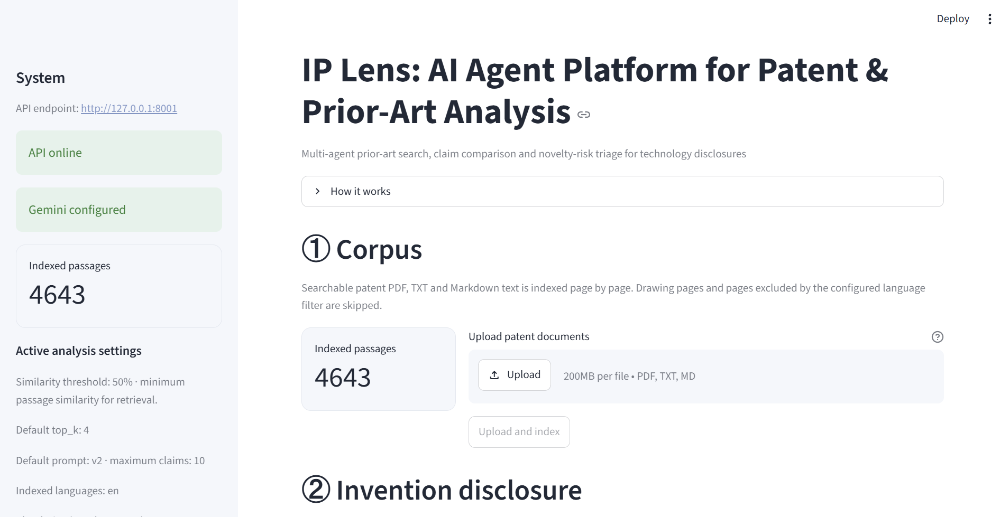
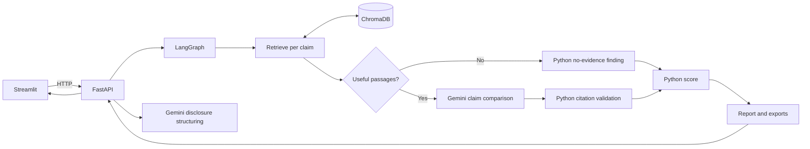
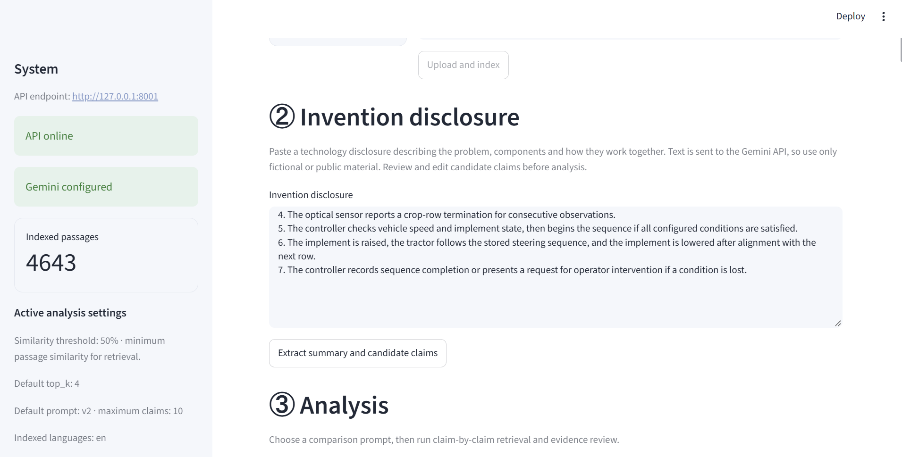
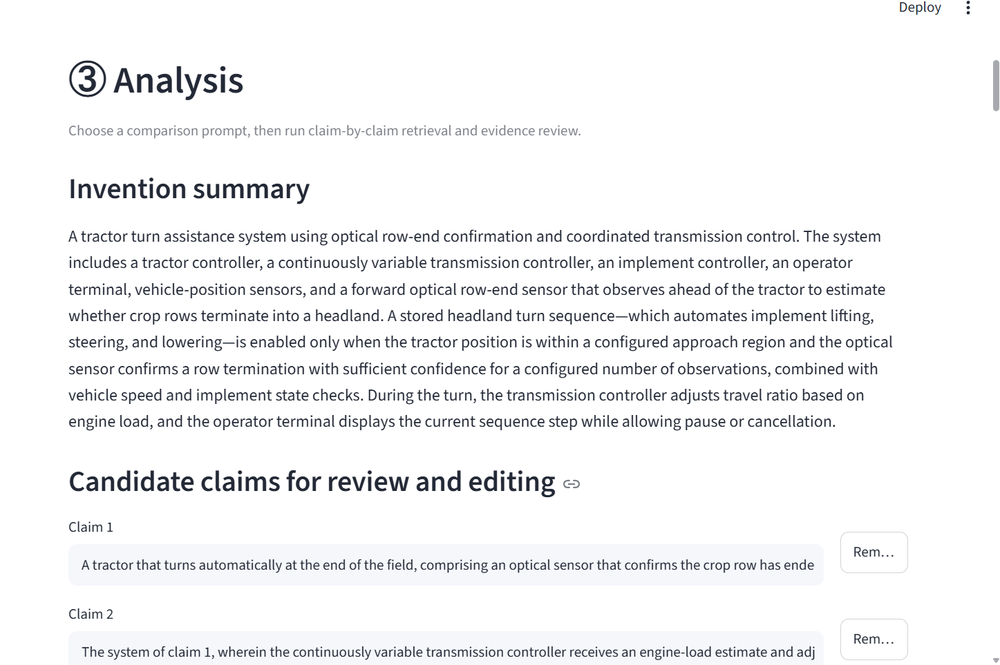
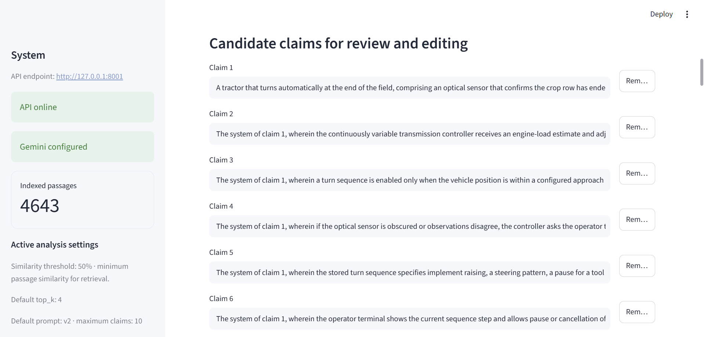
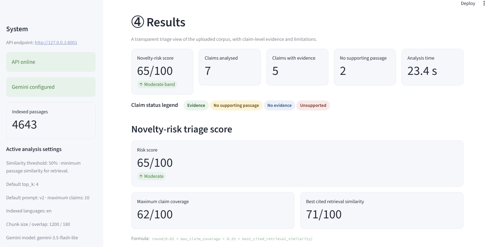
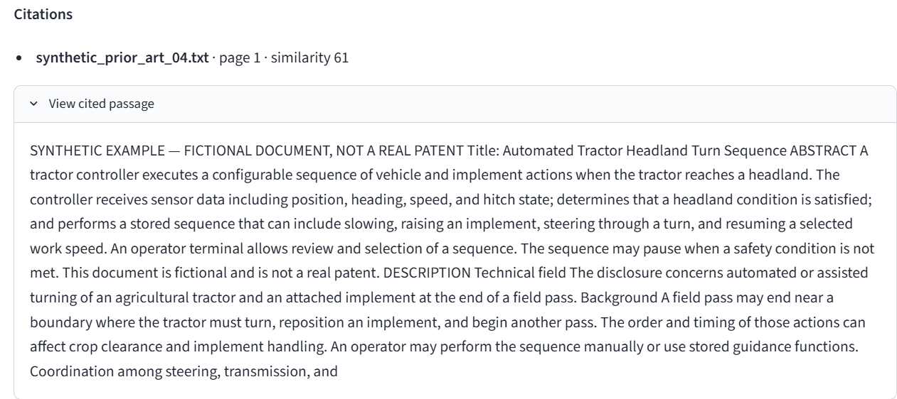
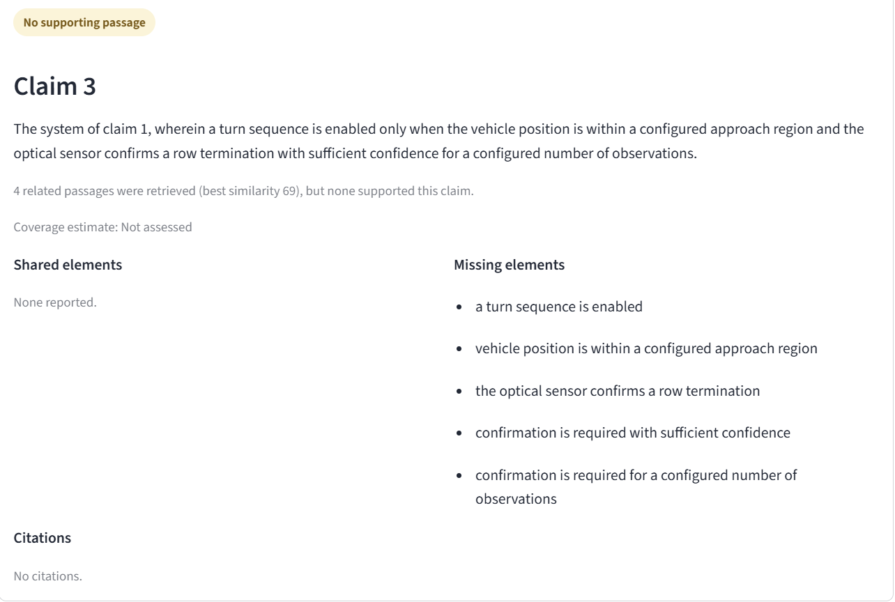

# IP Lens: AI Agent Platform for Automated Patent and Intellectual Property Analysis

A multi-agent tool for prior-art search, claim comparison and novelty-risk scoring of technology disclosures.

[](https://www.python.org/)
[](https://www.langchain.com/langgraph)
[](https://fastapi.tiangolo.com/)
[](https://www.trychroma.com/)
[](https://ai.google.dev/)
[](https://streamlit.io/)



IP Lens checks a new invention against a collection of patent documents. For each claim, it shows which features already appear in the documents, which are missing, and the exact document and page for every finding.

It only searches the documents you upload. It does not search patent-office databases or the web, and it does not give legal advice or decide whether something can be patented. The expert makes that decision.

## What it does

- Reads searchable PDF, TXT and Markdown files page by page. Drawing pages and pages in other languages are skipped. Scanned PDFs are not supported, because there is no OCR.
- A Gemini agent turns the invention description into a summary and a list of claims. The user can review and edit them.
- For each claim, the system searches for the most similar passages. If any are relevant enough, a second Gemini agent compares the claim with them, feature by feature.
- Python checks the citations, sets the status of each claim, calculates the score and builds the report.
- Every report can be downloaded as JSON or Markdown.

Gemini is only used for two steps: structuring the disclosure and comparing claims. Search, routing, citation checks, scoring and the report are normal application code. The Streamlit UI talks to the FastAPI backend over HTTP.

## Architecture



## Claim results and score

Each claim gets one of four results:

- Evidence: a relevant passage was cited, and the citation was checked.
- No supporting passage: relevant passages were found, but none of them support the claim.
- No evidence: no passage was similar enough.
- Unsupported: the model cited passages that could not be matched to the retrieved ones.

The score is calculated as `round(0.65 * max_claim_coverage + 0.35 * best_cited_retrieval_similarity)`.

- Low: 0 to 34
- Moderate: 35 to 69
- High: 70 to 100

If no claim has a checked citation, the result is "Not scored". The score is a rough guide for review over the uploaded documents only. It is not a probability or a legal conclusion.

## Setup

You need Python 3.12 (set in `.python-version`) and [uv](https://docs.astral.sh/uv/). In the project folder, run:

```powershell
uv sync
Copy-Item .env.example .env
```

Add your `GEMINI_API_KEY` to `.env`. The default settings are `MIN_SIMILARITY=50` and `DEFAULT_TOP_K=4`. Keep `.env` private.

The disclosure text and the retrieved passages are sent to the Gemini API, so don't use confidential inventions with this setup.

### Run locally

Use two terminals.

Terminal 1, the API on port 8001:

```powershell
uv run python -m uvicorn backend.app.main:app --reload --port 8001
```

You can check it at `http://127.0.0.1:8001/health`, and see the API docs at `http://127.0.0.1:8001/docs`.

Terminal 2, the Streamlit UI:

```powershell
uv run python -m streamlit run frontend/streamlit_app.py
```

Open the address Streamlit prints. The UI connects to port 8001 through `API_BASE_URL` in `.env.example`, so it doesn't clash with other projects on port 8000.

### Load the demo documents

For the demo, upload the five fictional documents in the Corpus section of the UI.

To load your own documents in one go, put them in the `examples/real/` folder (it is not committed to Git) and run:

```powershell
New-Item -ItemType Directory -Force examples/real
uv run python scripts/ingest_folder.py examples/real
```

Then paste the text from [`examples/demo_disclosure.md`](examples/demo_disclosure.md), check the suggested claims, and run the analysis. [`examples/demo_claims.json`](examples/demo_claims.json) has four prepared claims for repeatable API tests. The Docker container loads the fictional documents automatically when its database is empty.

## Evaluation

Retrieval was tested on 13 claims with a known correct answer:

- The correct document was ranked first for 12 of 13 claims, and was in the top 4 for all 13.
- The exact labelled passage was ranked first for 1 of 13, and was in the top 4 for 10 of 13.

A similarity threshold of 50 was the lowest tested value at which neither of the two "no answer" test claims returned a passage.

Two versions of the comparison prompt were tested on 7 cases, 3 runs each. Both returned valid output in all 21 runs. Version 2 was more consistent: the average variation in coverage dropped from 7.5 to 2.0 points, and it stopped producing elements that only referred to other claims (0 instead of 7). This is a small test and does not prove general accuracy.

More detail: [evaluation](docs/EVALUATION.md), [testing guide](docs/15-TESTING-AND-EVALUATION.md) and [project overview](docs/PROJECT_OVERVIEW.md). Example outputs: [demo report](docs/sample_report_demo.md) and [prompt comparison](docs/prompt_comparison_v1_v2.md).

## Deployment

### Run with Docker

```powershell
docker build -t ip-lens .
docker run -p 7860:7860 --env-file .env ip-lens
```

Open `http://localhost:7860`. The image uses Python 3.12, runs as a non-root user, and loads the fictional documents if the database is empty. The API runs inside the container on port 8001; only the Streamlit port 7860 is exposed.

The container starts in demo mode (`DEMO_MODE=true`). In demo mode, analyses are limited to 4 claims and uploads to 2 MB per file, and uploads are off unless `DEMO_ALLOW_UPLOADS=true`. If `ACCESS_CODE` is set, the UI asks for it before running anything. `GEMINI_MODEL` selects the model. None of these limits apply when running locally without these settings.

### Hugging Face Space

Create a Docker Space named `ip-lens`. Add `GEMINI_API_KEY` and, if you want, `ACCESS_CODE` as Space secrets, and `GEMINI_MODEL` and `DEMO_MODE` as Space variables. The online demo only has the fictional documents, and free Spaces can be slow to start after a break.

## Limitations

- It only searches the uploaded documents, so it is not a complete prior-art search.
- Only English text is indexed by default. German-language patents are skipped.
- Similarity and the model's coverage judgements are not perfect. Results always need to be checked against the original documents.
- The prompt test used 7 cases and one model, and the extra test claims were easy.
- Gemini receives the disclosure and the retrieved passages, so the public API is not suitable for confidential material.
- Scanned PDFs are not supported, and drawing-page detection can sometimes skip useful text.
- The access code is a simple gate for the demo, not a real login system.

## Troubleshooting

| Problem | What to check |
|---|---|
| Wrong folder | Run commands in the `IP-Lens-Project` folder, where `pyproject.toml` is. |
| Port already in use | Stop the other program using port 8001, or use another port and update `API_BASE_URL`. |
| API not running | Start the API in terminal 1, then refresh the Streamlit page. |
| Windows blocks `streamlit` or `uvicorn` | Use the `uv run python -m ...` commands shown above. |
| Gemini rate limit | Wait a moment and try again. |
| Space sleeping | Free Spaces go to sleep. Wait for it to start, then reload. |

More technical detail: [project overview](docs/PROJECT_OVERVIEW.md), [specification](PROJECT_SPECIFICATION.md) and [design changes](DESIGN-CHANGES.md).

## Screenshots

Corpus overview


Invention disclosure



Invention summary from the first agent



Claims after review



Novelty-risk score



Claim 1: prior art found, optical sensor missing


Cited passage with document and page



Claim 3: related passages found, but none support the claim

