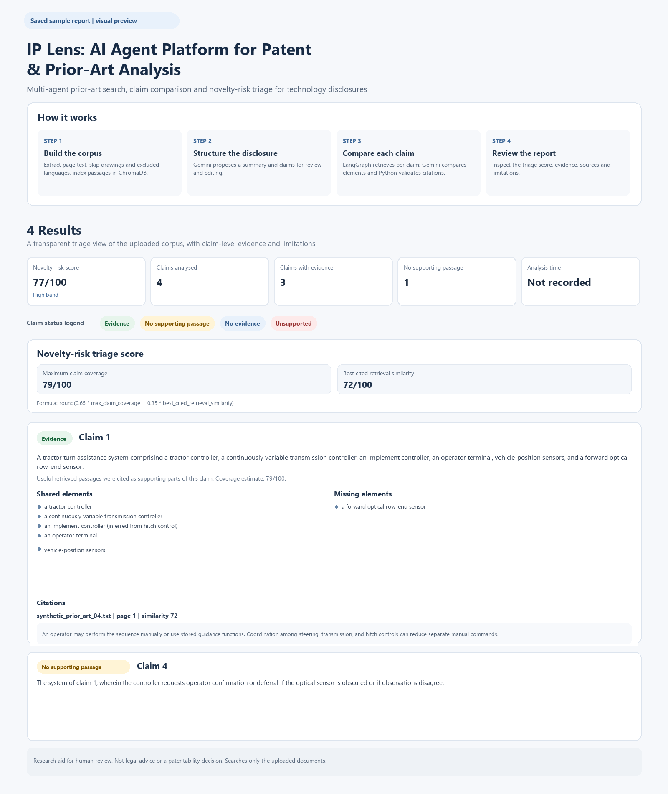
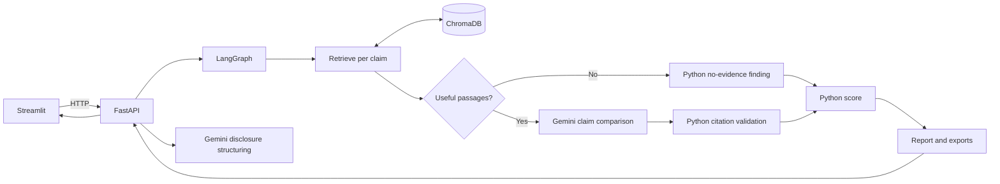

# IP Lens: AI Agent Platform for Patent & Prior-Art Analysis

Multi-agent prior-art search, claim comparison and novelty-risk triage for technology disclosures.

[](https://www.python.org/)
[](https://www.langchain.com/langgraph)
[](https://fastapi.tiangolo.com/)
[](https://www.trychroma.com/)
[](https://ai.google.dev/)
[](https://streamlit.io/)

**Live demo:** `https://huggingface.co/spaces/<HF_USERNAME>/ip-lens` *(placeholder until the Space is published).* The public demo uses fictional documents only.



IP Lens searches only documents uploaded to its corpus and presents source-linked findings for human review. It is a research aid, not legal advice or a patentability decision. It does not search patent-office databases or the public web.

## What it does

- Extracts page-aware text from searchable PDF, TXT and Markdown files. Drawing pages and pages excluded by the configured language filter are skipped; scanned PDFs are unsupported because OCR is not implemented.
- Uses a Gemini agent to structure a disclosure into a summary and candidate claims for review and editing.
- Retrieves passages separately for each reviewed claim and uses a second Gemini agent to compare elements when useful passages exist.
- Validates citations, assigns finding statuses, calculates the score and assembles reports in Python.
- Exports each validated report as JSON and Markdown.

The two Gemini-backed steps are disclosure structuring and claim comparison. Retrieval, workflow routing, citation validation, scoring and report assembly remain in application code. Streamlit calls FastAPI over HTTP; it does not import backend services.

## Architecture



## Findings and score

The four claim statuses are:

- **Evidence** (`evidence`): a useful retrieved passage was cited and validated.
- **No supporting passage** (`no_supporting_passage`): useful passages were retrieved, but none supported the claim.
- **No evidence** (`no_evidence`): no passage reached the similarity threshold.
- **Unsupported** (`unsupported`): the model returned citations that could not be matched to retrieved passages.

The score is `round(0.65 * max_claim_coverage + 0.35 * best_cited_retrieval_similarity)`. Bands are Low (0–34), Moderate (35–69) and High (70–100). If no claim has a validated evidence citation, the score is null and the band is **Not scored**. The score is an unvalidated triage heuristic over the uploaded corpus, not a probability or legal conclusion.

## Setup

Use Python 3.12, the version pinned in `.python-version`, and install [uv](https://docs.astral.sh/uv/). From the repository root:

```powershell
uv sync
Copy-Item .env.example .env
```

Set `GEMINI_API_KEY` in `.env`. The defaults are `MIN_SIMILARITY=50` and `DEFAULT_TOP_K=4`. Keep `.env` private. Disclosure text and retrieved excerpts are sent to the configured Gemini API, so do not use confidential invention material with this setup.

### Run locally (two terminals)

In terminal 1, start the API on port 8001:

```powershell
uv run uvicorn backend.app.main:app --reload --port 8001
```

The API health check and interactive docs are at `http://127.0.0.1:8001/health` and `http://127.0.0.1:8001/docs`.

In terminal 2, start Streamlit:

```powershell
uv run streamlit run frontend/streamlit_app.py
```

Open the local URL printed by Streamlit. `API_BASE_URL` in `.env.example` points the UI to port 8001 to avoid clashing with projects that use port 8000.

### Load the fictional demo corpus

For the fictional demo, upload the five synthetic documents using the Corpus section. To bulk-ingest your own local documents through the existing ingestion service, place supported files in the ignored `examples/real/` directory:

```powershell
New-Item -ItemType Directory -Force examples/real
uv run python scripts/ingest_folder.py examples/real
```

Then use [`examples/demo_disclosure.md`](examples/demo_disclosure.md), review/edit the generated claims, and run the analysis. [`examples/demo_claims.json`](examples/demo_claims.json) contains four prepared claim texts for reproducible API requests. The container seeds the synthetic prior-art corpus automatically when its ChromaDB store is empty.

## Evaluation

The recorded retrieval evaluation used 13 answerable labels. Chunk-level Recall@1 was 1/13 (7.7%) and Recall@4 was 10/13 (76.9%); document-level Recall@1 was 12/13 (92.3%) and Recall@4 was 13/13 (100%). Threshold 50 was the lowest tested threshold at which neither no-answer claim returned a passage.

In the recorded seven-case prompt comparison, v1 and v2 were schema-valid in 21/21 attempts with no discarded citations. v2 had a lower mean coverage spread (2.0 vs 7.5) and no claim-reference elements (0 vs 7). The sample is small and does not establish accuracy or generalization. Details and limitations are in [`docs/EVALUATION.md`](docs/EVALUATION.md), the [testing guide](docs/15-TESTING-AND-EVALUATION.md), and the [code-checked project overview](docs/PROJECT_OVERVIEW.md).

Sample files: [demo report](docs/sample_report_demo.md) and [v1/v2 prompt comparison](docs/prompt_comparison_v1_v2.md).

## Deployment

### Run the container locally

```powershell
docker build -t ip-lens .
docker run -p 7860:7860 --env-file .env ip-lens
```

Open `http://localhost:7860`. The image uses Python 3.12, installs the locked dependencies, runs as a non-root user, downloads ChromaDB’s default embedding model during the build, and seeds the fictional corpus if it is empty. The API listens on container loopback port 8001; only Streamlit port 7860 is published.

The container defaults to `DEMO_MODE=true`. Set `GEMINI_API_KEY` and optionally `ACCESS_CODE` in `.env`; `GEMINI_MODEL` selects the Gemini model. `DEMO_MODE` shows the public-demo notice and limits the API to four claims and 2 MB per uploaded file. Uploads are disabled unless `DEMO_ALLOW_UPLOADS=true`. If `ACCESS_CODE` is set, the UI requires it before disclosure extraction or analysis. These controls are inactive in a local setup when their variables are unset.

### Hugging Face Space

Create a Docker Space named `ip-lens` and set the Space secrets `GEMINI_API_KEY` and, if desired, `ACCESS_CODE`. Configure `GEMINI_MODEL` and `DEMO_MODE` as Space variables; leave `DEMO_ALLOW_UPLOADS` unset or false unless uploads are needed. The demo is limited to the synthetic corpus, free-tier speed and possible cold starts.

The GitHub Actions workflow `.github/workflows/deploy-hf.yml` tests pushes to `main` and manual runs before deploying. Add repository secrets `HF_TOKEN` (write access to the Space) and `HF_USERNAME`. After the test job passes, the workflow prepends `deploy/hf_space_header.md` in its CI workspace and force-pushes the tested source to the Space. It does not modify the GitHub README or repository history.

## Limitations

- Search covers only the indexed corpus; it is not an exhaustive prior-art search.
- English is indexed by default. German-language publications are excluded under the recorded evaluation configuration.
- Similarity and model-generated coverage are imperfect signals. The report requires human review of source passages and original documents.
- The comparison evaluation used seven cases and one model; the held-out claims were easy, single-feature matches.
- Gemini receives the disclosure and retrieved excerpts. The public API is unsuitable for confidential material.
- Scanned PDFs are unsupported. Drawing-page detection is heuristic and can skip useful figure labels.
- The demo access code is a UI gate, not a user account or enterprise authentication system. Keep the internal API bound to loopback in the container deployment.

## Troubleshooting

| Symptom | What to check |
|---|---|
| Wrong folder | Run commands from the `IP-Lens-Project` repository root, where `pyproject.toml` and `uv.lock` are located. |
| Port already in use | Stop the process using 8001, or choose another API port and set the matching `API_BASE_URL`. |
| API not running | Start the API in terminal 1 on port 8001, then refresh Streamlit. |
| Gemini rate limit | Wait briefly and retry; extraction returns 429, while analysis provider errors are reported safely. |
| Space sleeping | Free-tier Spaces can cold-start; wait for the Space to wake and reload the page. |

For implementation details, see [`docs/PROJECT_OVERVIEW.md`](docs/PROJECT_OVERVIEW.md), [`PROJECT_SPECIFICATION.md`](PROJECT_SPECIFICATION.md), and [`DESIGN-CHANGES.md`](DESIGN-CHANGES.md).
