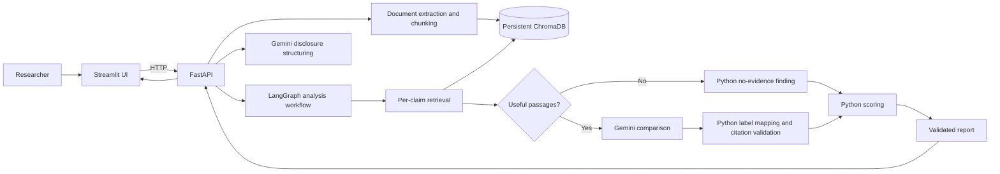

# 03 — Architecture

## Component map

## Responsibilities

| Component | Owns | Must not own |
|---|---|---|
| Streamlit | User interaction, progress, evidence display, downloads | Chroma calls, prompt logic, score calculation |
| FastAPI | Request validation, file limits, service coordination, HTTP errors | Model-specific prompt strings or UI state |
| Document services | File parsing, source/page metadata, chunking | Claim similarity judgments |
| Vector-store service | Persistent local index and retrieval primitives | Generative comparison or legal conclusions |
| Gemini client | Provider configuration, structured calls, timeout/error mapping | Final scores or source metadata |
| LangGraph | State transitions and specialist-step orchestration | HTTP response serialization or UI rendering |
| Workflow and report services | Citation validation in the workflow; deterministic scoring and exports in the report service | Invented citations or model-calculated scores |

## Data path

1. The user uploads files. The API validates extension and size before processing.
2. Parsers return text associated with a source filename and page marker.
3. Page-aware chunking creates stable document and chunk IDs.
4. ChromaDB stores text with metadata and local embeddings.
5. The user submits a disclosure, reviews candidate claims, and starts an analysis.
6. LangGraph retrieves evidence per claim, calls Gemini only for claims with useful passages, maps passage labels to retrieved chunks, validates citations, and computes the score in Python.
7. FastAPI returns one structured report, including analysis settings and exports. Streamlit renders the report and offers JSON/Markdown downloads.

## Trust boundaries

The uploaded corpus and disclosure text are untrusted input. They can contain prompt-like text; model instructions must treat them only as data. Gemini is an external provider: disclosure text and retrieved excerpts leave the local machine for generation. ChromaDB and uploaded files are local MVP data, not encrypted multi-user storage. The app has no authentication or tenant isolation, so it is intended for one local user.

## Operational simplicity

Run the API and Streamlit in separate local processes. ChromaDB uses a persistent directory under ignored `data/`. No queue, microservice mesh, cloud database, or external patent API is needed for the MVP.

