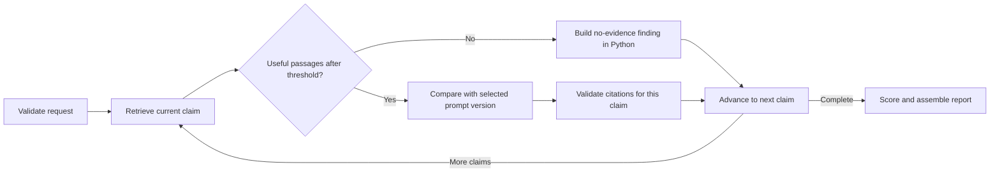

# 12 — LangGraph Analysis Workflow

## Graph state and routing

The typed state carries an analysis ID, disclosure text, reviewed claims and IDs, current claim index, per-claim retrieval results and findings, score/report fields, per-node durations, and status/error. It does not contain full source documents.

The workflow defaults to comparison prompt v2. A request may choose v1. Retrieval is per claim and applies the configured `top_k` and `MIN_SIMILARITY` before routing.

## Finding statuses

- `no_evidence`: no passage reached the threshold; Python creates this finding without a Gemini call.
- `no_supporting_passage`: passages reached the threshold and were compared, but Gemini cited none. Model shared/missing elements and assessment are retained; coverage and citations are empty.
- `unsupported`: Gemini returned citation labels, but all failed to map to retrieved passages. Coverage and citations are empty.
- `evidence`: at least one citation maps to a retrieved passage for that claim and survives validation.

Only `evidence` findings contribute to the score. The workflow records the number of useful passages and best retrieval similarity on each finding.

## Failures and timing

Invalid input stops before model calls. Gemini errors stop the analysis with a safe service error instead of a fabricated finding. Each executed graph node records its duration in milliseconds; the report/UI provide the per-node durations and summed analysis duration. A no-evidence result does not by itself make the overall report `Not scored`; that band is used only when no evidence finding contributes to the score.
