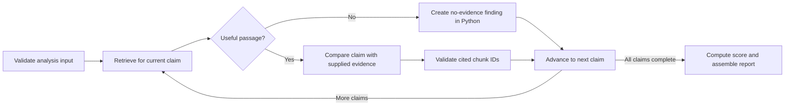

# 12 — LangGraph Analysis Workflow

## Graph state

Use a typed state model with the analysis ID, disclosure text, exact reviewed claims, current claim index, retrieval results keyed by claim ID, validated findings, score/report fields, and a safe error/status field. Avoid putting uploaded full documents in graph state; pass only the necessary excerpts and identifiers.

## Nodes and routing

The exact node names may vary, but each responsibility must remain explicit. Retrieval and no-evidence handling should be application code. Gemini is called only by the comparison node when useful passages exist.

## Per-claim flow

1. Select the next user-reviewed claim without rewriting it.
2. Retrieve candidates from ChromaDB using the configured `top_k` and threshold.
3. If the list is empty, build a no-evidence finding with no citations.
4. Otherwise call the comparison service with that claim and only its retrieved excerpts.
5. Validate each proposed chunk ID against the current claim's result set and enrich valid citations from trusted stored metadata.
6. Append the finding and move to the next claim.
7. When all claims finish, call deterministic report/scoring code.

## Failure behavior

Invalid request state should stop before model calls. Gemini errors should produce a clear API service error rather than a fabricated partial finding. Invalid citations are discarded; they must never be rendered as valid evidence. An empty corpus or no passages above threshold remains a completed analysis with no evidence and `Not scored` when there are no valid citations.

## Timing

Wrap each node so it records its start and end time in the state. Return per-node and total durations in the analysis response and write them to the server log. These measurements feed the timing section of `docs/EVALUATION.md`; do not describe the system as low-latency without them.

## Keeping the graph bounded

The MVP analyzes only the claims submitted in one request, with a maximum claim count and input-size limit set in configuration. It does not let the model choose tools, call arbitrary URLs, write to the file system, or expand the search beyond ChromaDB.

